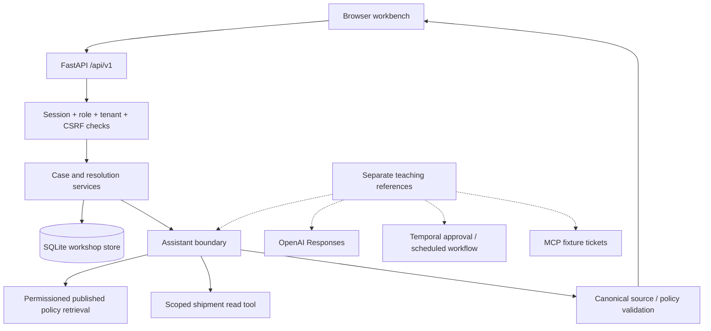

# Relay — product and technical design

Status: active replacement design, 19 October 2026. The owner authorized the expanded AI engineering/FDE scope and implementation. Superseded specifications and implementations are preserved in historical Git tags, outside the current working tree. The [coverage blueprint](AI_ENGINEERING_AND_FDE_BLUEPRINT.md) records the complete topic inventory; this document defines the product that makes those topics concrete.

## Product decision

Build **Relay**, a support-resolution workbench for the fictional Nigerian logistics company **Kora Dispatch**. A support agent opens a delivery case, checks shipment facts, retrieves applicable policy, and proposes a service credit. A supervisor reviews the exact amount/reason. Approved credits enter a local ledger exactly once. No real customer messages, payments, ticket writes or production deployments are authorized by this implementation.

This workflow fits the expanded curriculum better than the game: its business outcome is easy to explain, its evidence can be inspected, and its permissions and side effects have practical consequences. It naturally supports RAG, tool calling, memory, approvals, reliable workflows, scheduling and Codex-assisted issue delivery without unrelated gameplay rules.

### Users and customer-discovery assumptions

- Support agent: understand the case, find authoritative guidance and prepare a resolution.
- Supervisor: review proposed credits and keep decisions accountable.
- Observer: inspect the local demonstration without business mutations.
- Operations/content owner: review policy changes before publication (Contact 3 reference).

These are synthetic discovery assumptions, not customer research findings. A real pilot needs stakeholder interviews, data/security owners, business metrics and explicit acceptance. Proposed metrics: time to reviewed resolution, incorrect credit rate, policy-support rate, escalation rate, and reviewer effort. Establish measured baselines before claiming improvement.

### First-minute experience

The local app opens into a seeded queue. Select the late-delivery case, choose **Investigate case**, inspect shipment/policy evidence, then **Propose a service credit**. Switch the explicitly labeled demo persona to the supervisor and review it. Navigation contains only Resolution desk, Knowledge library and Activity. The interface makes provider mode, approvals and local-only effects visible without turning the product into a course dashboard.

## Architecture

### Foundation stack

- Python 3.12 reference runtime; FastAPI, Pydantic, Uvicorn; exact resolved versions in `workbench/uv.lock`.
- A buildless HTML/CSS/JavaScript frontend served by FastAPI on the same origin. This reduces setup overhead and avoids a second auth/API proxy. An API-first architecture allows a React client later without moving business invariants.
- SQLite with explicit schema version, parameterized SQL, short-lived connections, WAL and transactional mutations. Local single-instance workshop target only; a real deployment must review managed persistence, migrations, background jobs and distributed limits.
- Cookie sessions with random opaque tokens hashed at rest, CSRF checks for mutations, role/tenant checks, request/body limits, stable errors, pagination and SSE transport.
- pytest/HTTPX for API/security/concurrency checks; Playwright for desktop/mobile workflows; a versioned local evaluation harness.
- Optional teaching SDKs are separate from baseline imports. Installing them does not activate them or send network traffic.

### Critical identity limitation

M0 uses **local demo identities**, not production authentication. A new browser gets its own isolated workspace; changing persona preserves that workspace and rotates its session. This is acceptable for a loopback workshop. App startup rejects non-local `RELAY_ENV` and requests reject non-loopback hosts. A separately authorized hosted-workshop mode now permits one configured HTTPS host, uses Secure cookies and enforces shared AI request limits. It remains a public synthetic demo with selectable personas and ephemeral state on Render Free; it adds no individual production identity. See [deployment](DEPLOYMENT.md). Production OIDC/SSO and real user provisioning remain release prerequisites, not claimed implemented capabilities. Ordinary API patterns are prepared for inspection; the slides spend only a few minutes on them.

## Data and trust boundaries

- All customers, shipment events and business policies are original synthetic fixtures. They are not Nigerian legal requirements or real company terms.
- Case identity and tenant derive from the server session. Client-supplied tenant/role fields are rejected.
- Retrieval receives only published, permissioned documents. Post-retrieval validation replaces returned text with canonical authorized passages. Candidate policies and another tenant's records never enter answer context.
- Tool results are obtained from the authorized case, not a model-provided arbitrary shipment ID.
- Models may propose text/actions; backend code enforces eligibility, limits and approvals. Prompts and skills are not authorization.
- Express shipments delivered more than 24 hours late may receive up to 25% of their fee, capped at ₦5,000. The seeded ₦8,000 fee permits a ₦2,000 credit. Address-change and damage cases require escalation rather than an automatic credit.
- Pending proposals have immutable amount/rationale. A decision refers to that exact proposal. Policy eligibility is rechecked at approval. Approval/rejection and case-version updates occur atomically.
- Idempotency binds key, operation, role and request payload. Retrying the same decision cannot create another ledger credit. Real external payments require a provider key plus an outbox/reconciliation design; the local ledger is not a payment integration.
- Saved exchanges are case/workspace scoped, opt-in per request, capped at 20 entries per visibility scope and deletable within the caller’s scope. This is persisted case history, not semantic long-term memory or a claim of multi-turn model reasoning. Audit records retain metadata, not prompts or raw answers.
- No raw credentials, user prompts or hidden model reasoning are logged. Local traces disclose fixture mode, source IDs, retrieval version, duration and unmeasured token fields.

## API surface

Self-hosted Swagger UI (offline, without third-party CDN assets or an online validator): `/docs`; machine-readable FastAPI contract: `/openapi.json`. Swagger requests reuse local cookie sessions and refresh CSRF tokens for mutations. All business routes use `/api/v1`.

| Route                                           | Purpose                                                                                       |
| ----------------------------------------------- | --------------------------------------------------------------------------------------------- |
| `GET /api/health`                               | Database readiness, provider/checkpoint and external-action status                            |
| `POST /api/v1/demo/session`                     | Create/rotate a local identity; existing session requires CSRF                                |
| `GET /api/v1/session`                           | Current role, CSRF token and checkpoint                                                       |
| `GET /api/v1/cases?limit=&offset=`              | Authorized queue with bounded pagination                                                      |
| `GET /api/v1/cases/{id}`                        | Case, shipment, saved exchanges and proposals                                                 |
| `POST /api/v1/cases/{id}/investigations`        | Structured investigation with evidence/tool records; explicit fixture or opt-in live provider |
| `POST /api/v1/cases/{id}/investigations/stream` | SSE completed-result transport; no fake model token stream                                    |
| `DELETE /api/v1/cases/{id}/memory`              | Delete saved case exchanges; retain decision audit metadata                                   |
| `GET /api/v1/knowledge`                         | Published documents allowed for the role/tenant                                               |
| `POST /api/v1/cases/{id}/proposals`             | Version-checked, policy-limited credit proposal; idempotency key required                     |
| `POST /api/v1/proposals/{id}/decision`          | Supervisor-only decision; idempotency key required                                            |
| `GET /api/v1/activity`                          | Workspace-scoped recent investigation/decision audit                                          |

Mutations require `X-CSRF-Token`. Proposal/decision requests additionally require `Idempotency-Key`. Errors use `error.code`, `error.message` and correlation ID where handled; they never echo validation input. Browser origin restrictions are enforced. No permissive CORS or forwarded-host trust is configured.

## Milestones and preserved teaching gaps

| Milestone           | Starting state and deliverable                                                                                         | Acceptance                                                                                                                                     |
| ------------------- | ---------------------------------------------------------------------------------------------------------------------- | ---------------------------------------------------------------------------------------------------------------------------------------------- |
| M0 before class     | Usable workbench, local identities, safe services, synthetic corpus, title-only fixture assistant, tests, eval harness | Zero model key; complete propose/review journey; permissions, policy limits, persistence and idempotency verified                              |
| C1 reference        | Better retrieval and grounded Responses adapter, evaluated separately                                                  | Measured baseline/reference comparison; source allowlist and refusal checks; provider mode disclosed; live quality only after credentialed run |
| C2 before/reference | Isolated duplicate-event defect, local ticket, failing regression and corrected handler                                | Red before / green reference; reviewed minimal diff; browser evidence; no deliberate defect in baseline services                               |
| C3 reference        | Bounded ingestion/review skill, MCP fixture integration, durable approval/scheduling example                           | Candidate injection/provenance checks, approval separation, duplicate handling; Temporal/MCP verification status recorded honestly             |
| C4 pack             | Evidence, incidents, pilot/governance decisions and readiness/practice checks                                          | No invented customer validation, integration success or deployment readiness                                                                   |

Baseline retrieval intentionally matches policy-title words only. A paraphrase such as “My parcel arrived overdue, any goodwill?” returns insufficient evidence. Contact 1 improves retrieval/grounding; do not silently route baseline to the reference. Deliberate Contact 2 bugs live only in teaching fixtures. Advanced reference files are opt-in, outside the application package and never automatic startup behavior.

## Integration roles and scope

- **OpenAI:** Responses structured answers and bounded function tools. Configure model, timeout and explicit live opt-in; use official SDK. No live call without configured access.
- **LangChain:** inspect chunking/component choices. **LangGraph:** explicit state/branching comparison. Neither owns baseline business authorization.
- **Langfuse:** versioned tracing/experiments; disabled by default. Exclude sensitive source/prompt payloads unless a reviewed data policy permits them.
- **Temporal:** durable business approval and recurring policy-freshness work. Separate model inference from durable orchestration and keep activities idempotent.
- **MCP:** read-only local ticket/reference tool first; actual Linear/GitHub connection is account-dependent and external writes require explicit authorization.
- **Codex:** investigate → reproduce → plan → patch → test → browser verify → review → PR. Include AGENTS.md, skills, worktrees, local/cloud and non-interactive/SDK references. Windsurf is a bounded comparison using the same acceptance criteria.
- **Advanced practice:** memory compaction, reranking/query-rewriting experiments, multi-agent, tool discovery/programmatic calls, multimodal inputs, realtime voice and model adaptation. Coverage is not a claim of completed live integrations.

## Deployment and release gate

The target is a reliable local teaching artifact, not a production deployment. Release requires real identity, approved data, suitable retention/residency, managed persistence, distributed throttling, spend limits, secrets management, signed webhooks, live evaluation, monitoring, incident ownership, backups, staged rollout and rollback rehearsal. Rehearse each contact and preflight account-dependent examples; maintain disclosed fixtures/replays.

Official implementation references: [structured outputs](https://developers.openai.com/api/docs/guides/structured-outputs), [function calling](https://developers.openai.com/api/docs/guides/function-calling), [FastAPI tests](https://fastapi.tiangolo.com/advanced/testing-events/). See the blueprint for the broader source review.

Contact 1 implementation: the baseline factory accepts an injected investigator without importing teaching modules. The explicit live profile composes OpenAI document/query embeddings, persistent local Qdrant with authorization filters before similarity scoring, a single read-only shipment tool and a structured answer request. Deterministic chunks carry source versions and exact offsets; index builds reuse unchanged embeddings and switch manifests atomically. The live demo defaults to hybrid RRF, combining vector search with permissioned lexical retrieval. Conservative one-missing-letter normalization uses only permitted policy title/tag vocabulary and preserves the original model question. Vector-only mode remains explicit for comparisons; the cosine cutoff is unchanged. The FTS-only profile remains an optional isolated historical checkpoint. The main Contact 1 demonstration stays in the live RAG app, from a support question to cited evidence and the generated answer. Indexing is explicit and billable; no baseline startup or silent fallback can activate it. It validates canonical citation IDs, calculates eligibility on the server, reports provider failures without fixture substitution, and optionally exports allowlisted metadata. Profile databases and cookie names are distinct. See [Contact 1 preparation](teaching/CONTACT_1_PREPARATION.md) for limits, evaluation and preflight.

The corrected Contact 1 runtime additionally supports explicit caller-managed case context, fixed workflow versus bounded read-only agent mode, and direct versus actual LangGraph execution of the same stages. Optional LangChain chunking feeds the real embedding index. Actual Responses streaming delivers progress while holding draft claims until validation. Nested execution observations replace the earlier summary-only Langfuse export. Evaluation includes separately budgeted uncalibrated model judges, unique run-bound human labels, repetitions/slices and supplied dated token-price estimates. These references expand preparation scope without changing the timetable or automatically activating in M0. See the [coverage audit](teaching/CONTACT_1_COVERAGE_AUDIT.md) for later-contact integration work that remains unimplemented.
