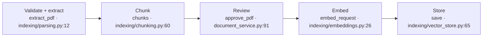
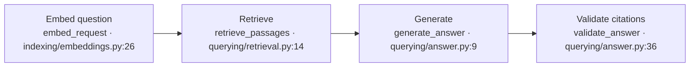

# Contact 2 · session notes

We’ll follow a policy PDF through a working RAG application, then use Codex to improve it. The aim is to understand the code, give the agent a clear task, check its work and leave a change another engineer can review.

These are my notes for the two-hour session. We’ll work in the app and editor, using the slides for short explanations along the way.

| Time        | What we’re doing                                                      | What we should have by the end                          |
| ----------- | --------------------------------------------------------------------- | ------------------------------------------------------- |
| 0–5 min     | Introduce the support problem and follow the code map.                | A clear picture of ingestion and retrieval.             |
| 5–30 min    | Upload a PDF, inspect the index and ask a question.                   | An answer we can check against the policy.              |
| 30–45 min   | Give Codex the page-reference task and review its plan.               | An agreed plan with acceptance criteria.                |
| 45–75 min   | Implement and test; discuss the Codex controls while it runs.         | Correct page references backed by tests.                |
| 75–90 min   | Package the procedure as a skill and query the docs through MCP.      | A reusable procedure and an inspected MCP call.         |
| 90–110 min  | Check the browser result, review the diff and prepare delivery notes. | Evidence that the change works and a reviewable diff.   |
| 110–120 min | Record the handover and connect context, memory and caching.          | Enough information to continue in a fresh conversation. |

The commands below run from the checkout we’re working in. The prompts are ready to copy into Codex.

## Before I start

I choose the starting point before opening the app:

- **Follow the finished example:** use `main`. Page references and the three repository skills are already implemented.
- **Do the coding exercise:** use **`contact-2-before`** in a separate checkout, following the commands below.

The `--state before` flag selects the separate Markdown exercise. It does not undo page references on `main`.

For a fresh practice checkout, I run this from the cloned repository:

```sh
git fetch origin --tags
git worktree add -b practice/contact-2 ../relay-contact2-practice contact-2-before
cd ../relay-contact2-practice
uv sync --project workbench --locked --extra references
pnpm install --frozen-lockfile
pnpm exec playwright install chromium
```

I open that folder in the IDE and use it for the rest of the exercise. If the folder or branch already exists, I inspect and reuse it or choose another name; I don’t reset existing work. For my own repeat run: `~/projects/relay-contact2-class` contains the changes from class. I use the fresh practice checkout above when I want the unfinished exercise.

In a new checkout, I copy `workbench/.env.example` to `workbench/.env`, then configure it locally. I keep an existing configured file rather than overwriting it. For the OpenRouter route used in class, the settings are:

```dotenv
RELAY_ENV=local
RELAY_AI_PROVIDER=openrouter
RELAY_ALLOW_LIVE=1
OPENROUTER_API_KEY=<my-funded-key>
OPENROUTER_MODEL=openai/gpt-4o
OPENROUTER_EMBEDDING_MODEL=openai/text-embedding-3-small
```

This is the configuration we used in class. I compare other models on the same task before changing it. Codex’s account and model selection are separate from Relay’s provider credentials. Local Qdrant needs no service key. I keep the environment file out of Git, screenshots and shared output.

From the working checkout, I start the app with:

```sh
uv run --project workbench --locked --extra references \
  --env-file workbench/.env \
  python workbench/scripts/contact2.py serve --state before --reload
```

One server, on **8002**, serves all of these:

| What we need    | Address                                  |
| --------------- | ---------------------------------------- |
| PDF assistant   | http://127.0.0.1:8002/teaching/contact-2 |
| Slides          | http://127.0.0.1:8002/course/contact-2   |
| Resolution desk | http://127.0.0.1:8002/dashboard          |
| Swagger         | http://127.0.0.1:8002/docs               |
| Health          | http://127.0.0.1:8002/api/health         |

The [course website](https://relay-workshop.onrender.com) has the course overview, [Contact 2 slides](https://relay-workshop.onrender.com/course/contact-2) and [resolution desk](https://relay-workshop.onrender.com/dashboard) once the latest update is deployed. **The PDF lab we used in class runs locally** at the address above. `pnpm dev` starts the ordinary baseline on 8000; I use the Contact 2 command for this session.

Before starting, I check the folder and branch, `git status --short`, the app’s health and the available skills/browser/MCP tools. A successful health response checks the server; it does not prove provider credit or answer quality. I don’t start a second server if 8002 is already occupied.

### What I keep open

| Item                          | Path from the working checkout                                     |
| ----------------------------- | ------------------------------------------------------------------ |
| Task and acceptance criteria  | `workbench/teaching/contact2/PAGE_REFERENCE_TASK.md`               |
| Project instructions          | `AGENTS.md` and `workbench/teaching/contact2/AGENTS.md`            |
| Main sample                   | `workbench/teaching/contact2/pdfs/collection-policy-multipage.pdf` |
| Second file for skill reuse   | `workbench/teaching/contact2/pdfs/collection-policy.pdf`           |
| Review skill                  | `.agents/skills/review-change/SKILL.md`                            |
| Browser skill                 | `.agents/skills/browser-smoke-check/SKILL.md`                      |
| Completed PDF skill on `main` | `.agents/skills/ingest-policy-pdf/SKILL.md`                        |

The three-page sample is an original fictional Kora Dispatch policy. Page 1 explains the seven-day holding period and notice date. Page 2 covers the collection code and identity check. Page 3 covers supervisor review before return. The one-page sample contains the same rules with different pagination.

The lab accepts text PDFs up to **2 MiB, ten pages and 50,000 extracted characters**. It rejects encrypted or image-only PDFs. Upload and preview run locally without a model call; indexing and answering use the configured provider after confirmation.

## 1. The problem we’re solving · 0–5 minutes

> Kora Dispatch’s policy team has sent us a PDF. Support agents need answers grounded in that policy. First, we’ll see how Relay reads it and answers questions. Then we’ll use Codex to improve the source references so an agent can find the supporting page in the original PDF.

**Goal:** understand the two pipelines, then improve the answer’s source references. We’ll finish with a tested change that shows the supporting PDF pages.

### The code map

```text
workbench/teaching/contact2/
├── config.py
├── document_service.py   # upload, review and removal
├── policy_store.py       # canonical sources and publication
├── indexing/
│   ├── parsing.py        # PDF → exact text and pages
│   ├── chunking.py       # text → passages
│   ├── embeddings.py     # passages/questions → vectors
│   ├── vector_store.py   # vectors + passages → Qdrant
│   └── pipeline.py       # preview_pdf() and build_index()
└── querying/
    ├── pipeline.py       # answer_question()
    ├── retrieval.py      # question → permitted passages
    └── answer.py         # evidence → answer + checked citations
```

I start with `indexing/pipeline.py`. `preview_pdf()` calls **parse → chunk** without a provider request. After review, `build_index()` calls **chunk → embed → store**. It chunks the approved canonical text again so indexing and retrieval use the same passages.

The FastAPI handlers are in `workbench/teaching/contact2_app.py`. **Upload and inspect** calls the upload endpoint. **Approve and index policy** sends the review request, waits for it to succeed, then sends the indexing request. The document service handles those records; the pipeline coordinates the RAG steps.

For questions, I start with `querying/pipeline.py`: `answer_question()` calls **retrieve_passages → generate_answer → validate_answer** directly.

<details>
<summary>Ingestion: PDF → passages → vectors → Qdrant</summary>



These locations match published `main`; lines differ in the before checkpoint. I follow the function names or use the UI’s copyable locations for the checkout I’m running.

1. [parsing.py:12](../../workbench/teaching/contact2/indexing/parsing.py#L12) — validate the PDF and extract its text.
2. [chunking.py:60](../../workbench/teaching/contact2/indexing/chunking.py#L60) — split it into passages with exact offsets.
3. [document_service.py:91](../../workbench/teaching/contact2/document_service.py#L91) — record source review.
4. [embeddings.py:26](../../workbench/teaching/contact2/indexing/embeddings.py#L26) — request embeddings for passages.
5. [vector_store.py:65](../../workbench/teaching/contact2/indexing/vector_store.py#L65) — store vectors alongside passage text and metadata.

The coordinator is [indexing/pipeline.py:28](../../workbench/teaching/contact2/indexing/pipeline.py#L28). Parsing uses pypdf; chunking supports the existing native splitter or LangChain’s recursive splitter; embeddings use the OpenAI SDK; storage uses Qdrant. I keep the selected splitter and embedding configuration consistent with the existing index. Changing either requires an appropriate rebuilt index.

</details>

<details>
<summary>Retrieval: question → passages → answer + citations</summary>



1. [embeddings.py:26](../../workbench/teaching/contact2/indexing/embeddings.py#L26) — embed the question using the same embedding model as the passages.
2. [retrieval.py:14](../../workbench/teaching/contact2/querying/retrieval.py#L14) — search permitted passages; hybrid mode also uses keyword ranking.
3. [answer.py:9](../../workbench/teaching/contact2/querying/answer.py#L9) — generate from the retrieved evidence.
4. [answer.py:36](../../workbench/teaching/contact2/querying/answer.py#L36) — validate the answer and cited passage IDs.

The coordinator is [querying/pipeline.py:22](../../workbench/teaching/contact2/querying/pipeline.py#L22). This path uses one ordinary JSON request to **`POST /api/v1/policies/query`**. It returns passages, scores, the answer and citations together. There is no streaming on this PDF path.

</details>

> We embed the policy passages when indexing. Later, we embed the question to find relevant passages. The answer model reads those passages; it does not search the PDF by itself.

## 2. Follow the working RAG flow · 5–30 minutes

**Goal:** follow one document from upload to a grounded answer.

I use the [three-page PDF](http://127.0.0.1:8002/teaching/contact-2/sample-multipage.pdf) from the PDF assistant. My demo sequence is:

1. I select the PDF and choose **Upload and inspect**.
2. I expand **Extracted text** and compare it with the original PDF.
3. I expand **Text chunks** and inspect boundaries, overlap and source details.
4. I review the source, confirm permission for the embedding request and choose **Approve and index policy**.
5. I expand **Embedding details** and **Qdrant record**. We check the vector length, sample values, passage text and metadata.
6. I ask:

   > How long can a parcel stay at a collection point, when does that period start, and who reviews return to the sender?

7. We compare the answer with **Retrieved passages** and the expanded source citations.

We expect seven calendar days from the first collection notice, with supervisor review before return. We check those facts against the passages rather than accepting the answer because it sounds confident.

For the query’s code path, I follow `contact2-pdf.js` → `contact2_app.py` (`query_policy`) → `querying/pipeline.py` (`answer_question`). Its three calls make the flow visible. Cosine similarity describes the vector match; the hybrid RRF rank is a separate score. Neither is a guarantee that the answer is correct.

The five RAG slides cover model roles, dimensions, chunking, retrieval settings and grounding. I open them only when we need the concept, then return to the app and code.

To repeat the upload, I use **Indexed policies → Remove policy**, confirm the intended sample and upload it again. Removal uses retained vectors without model calls; re-indexing can require new embeddings. I leave unrelated policies and the runtime database alone.

## 3. Give Codex a clear task · 30–45 minutes

**Goal:** turn a product requirement into a task Codex can investigate, plan and verify.

I confirm the working folder and branch, then open the root and applicable nested `AGENTS.md` files. The project instructions describe how we work; the task prompt describes what we want changed.

I check the selected model, reasoning effort and permissions. Then I select **Plan mode** and send:

```text
Improve Relay’s PDF assistant so retrieved passages and answer citations show
which original PDF page or pages support them.

Investigate the existing extraction-to-citation flow and propose a plan first.
Read the root AGENTS.md and all applicable nested AGENTS.md files for the
code you inspect or edit, including workbench/teaching/contact2/AGENTS.md.
Then read workbench/teaching/contact2/PAGE_REFERENCE_TASK.md.
Preserve exact extracted text, access checks, review requirements and existing
citations. Derive page numbers from source metadata, not from the model.

Acceptance: a passage on page 2 shows page 2; a passage spanning pages shows
the correct range; existing PDF ingestion and permission checks still pass.
Verify the visible result and report the actual tests. No external writes
or deployment.
```

This is a **structured zero-shot prompt**: objective, context, constraints, acceptance criteria and verification, without a worked example. One example makes it one-shot; several make it few-shot. We choose examples when they clarify the task, not because every prompt needs them.

I review whether the plan covers extraction metadata, exact offsets, storage, retrieval, API serialization, UI labels and tests. I ask for revisions before implementation if anything is unclear.

**Plan mode holds implementation edits.** Sending “implement” while it remains active can leave Codex updating the plan instead. I can either switch out of Plan mode and send an implementation prompt, or click **Implement this plan**, which moves into implementation. In normal mode, “plan first” can mean plan and then continue; “plan only, do not edit, then wait” requests an explicit pause.

For this exercise, I switch out of Plan mode and send:

```text
Implement the agreed plan in this class checkout. First add a regression test
that fails because page references are absent, then make it pass. Use disposable
test stores and fixture provider responses; no billable calls for these tests.
Preserve the task's acceptance criteria. Report changed files, actual commands,
results and any remaining gaps. Do not commit, publish or deploy.
```

## 4. Build and check the improvement · 45–75 minutes

**Goal:** carry trusted page metadata through the existing flow and prove it reaches the UI.

At the before checkpoint, the source identifies the policy and excerpt but not the supporting PDF page. We want **Page 2** for a passage on that page and **Pages 1–2** for one spanning the boundary.

From the working checkout, I run the unchanged acceptance checks:

```sh
workbench/.venv/bin/python -m pytest -c workbench/pyproject.toml \
  workbench/teaching/contact2/reference_tests/page_reference_acceptance.py -q
```

At `contact-2-before`, the expected result is **five failures**, with no provider calls. After implementation, it is **five passes**. On current `main`, these checks already pass. I keep the acceptance file unchanged.

As Codex works, I follow one page reference from extraction through chunks, storage, retrieval and the final source label. I inspect test failures and corrections: **edit → test → inspect feedback → improve**.

### While the implementation runs

After slide 9, I use slides 10–15 for a short tour. I return to the implementation when it is ready, keeping this inside the same 30-minute block.

| Slide                     | What we’re connecting to the task                                                                                               |
| ------------------------- | ------------------------------------------------------------------------------------------------------------------------------- |
| 10 · Caching              | Matching input can reuse computation. Cached tokens, saved history and stored embeddings are different.                         |
| 11 · Models               | Luna suits focused work; Sol is a practical choice for this change; Astra suits harder workflows. We compare results and usage. |
| 12 · Effort and speed     | Reasoning effort changes depth. Fast is a separate speed/usage setting.                                                         |
| 13 · Cost                 | The dated credit table shows why an older model is not automatically cheaper.                                                   |
| 14 · Status and documents | `/status` reports session information. Pages and repository documents hold work we can refer to.                                |
| 15 · Permissions          | The sandbox sets the boundary; approvals determine when and who reviews an action.                                              |

I show the available controls without changing the running task’s settings. Command names and fields vary between the CLI, IDE and desktop app. Pages is documented under ChatGPT Space; it is not a universal IDE-extension feature. The slides link to official sources checked on **23 October 2026**. I recheck prices and availability before reusing those comparisons.

### Check the visible result

The PDF indexed before the change has no saved page ranges. I record its original result, remove that sample through **Indexed policies**, then upload, review and index it again. We repeat the same question and inspect the new page labels beside passages and source citations. The printed “Page 3 of 3” inside an excerpt is PDF text; it is not the new citation label.

That repeats the **PDF → index → question** flow once, not the coding exercise. We use a fresh source record rather than resetting the database.

### Optional: Goals and continuation

A tool loop happens inside a run. Our engineering loop uses tests and feedback. A Goal can keep a task objective attached across turns, within its permissions and stopping conditions.

After the implementation is saved, I can use a separate task with this objective:

```text
Inspect the PDF page-reference change against PAGE_REFERENCE_TASK.md.
Report each criterion as met, unmet or unverified, with file locations.
Do not edit files, make provider calls or publish anything.
```

Where available, the CLI controls are `/goal <objective>`, `/goal pause`, `/goal resume` and `/goal clear`. I check the installed client before relying on these controls. Our recorded repair attempts are evidence of a bounded engineering loop, not proof that the native Goal lifecycle was exercised. Ralph-style outer loops are an optional comparison, not required for this task. [Goals reference](https://developers.openai.com/cookbook/examples/codex/using_goals_in_codex)

## 5. Make the procedure reusable, then use MCP · 75–90 minutes

### Repository skills

**Goal:** reuse instructions through a skill, then inspect a real external tool call through MCP.

We already have `review-change` and `browser-smoke-check`: general engineering procedures we can use on other changes too. Each has a `SKILL.md` with a name, description and instructions.

Codex discovers repository skills in `.agents/skills/` within the applicable directory scope. It initially sees their names and descriptions, then reads the full instructions when it uses a skill. **`$skill-name` invokes a skill; `/skills` opens the selector.** A skill can be invoked on its own, with extra task details when we want to narrow its focus. [Skill discovery](https://learn.chatgpt.com/docs/build-skills)

For the third skill, we package the existing PDF procedure. In the before checkpoint, I invoke Skill Creator and send:

```text
$skill-creator
Create an instruction-only repository skill named ingest-policy-pdf at
.agents/skills/ingest-policy-pdf/SKILL.md in this class checkout.

It should reuse Relay's existing PDF assistant at
http://127.0.0.1:8002/teaching/contact-2, not implement another pipeline.

Inputs: PDF path, policy title, test question and expected supporting facts.
Use the project's browser tools to upload and preview the PDF. Report the
extracted text and chunks, then stop for my source-review and billable-call
confirmation unless I have already explicitly provided it for this file.
Only then index it, ask the question and inspect the supporting citation.
Check page references if the page-number feature is available; otherwise
report that limitation. Report the source ID, result and actual evidence.

Use local teaching data only. Do not approve source content on my behalf,
read credentials, remove existing policies, install globally or deploy.
Do not run ingestion while authoring the skill. Create only the skill file.
```

On current `main`, that skill already exists. I inspect and reuse it rather than asking Codex to overwrite it. If a new skill does not appear automatically, I restart Codex. A plugin can distribute skills and integrations together, but these repository skills need no plugin installation.

Before trying the second PDF, I record the first result and remove only the earlier collection-policy samples myself. The one-page and three-page PDFs contain the same rules; leaving both indexed could let an answer cite the earlier source instead of proving that the new upload worked. The skill receives no removal permission.

I invoke:

```text
$ingest-policy-pdf
PDF: workbench/teaching/contact2/pdfs/collection-policy.pdf
Title: Parcel collection and return policy
Question: What must the recipient present when collecting a parcel?
Expected facts: the collection code and a matching identity document.

Upload and preview only. Show me the extracted text and chunks, and stop
before indexing or asking the model.
```

After reviewing the preview, I can authorize this specific file:

```text
I have reviewed this extracted policy and confirm permission for its teaching
use. Continue with indexing and one answer request using the configured
provider, then verify the source citation. Do not remove other policies.
```

We inspect the actual browser/tool calls and result. The skill supplies the procedure; the tools execute it. If browser tools are unavailable, that is a missing capability—not a successful ingestion. The cited source ID should match this upload, and the passage should support the expected facts.

### Documentation through MCP

I configure the connection before the session. In the desktop client, the documented route is **Settings → MCP servers → Add server**; in the IDE extension, **gear menu → MCP servers → Add server**, where available.

| Field     | Value                               |
| --------- | ----------------------------------- |
| Name      | `openaiDeveloperDocs`               |
| Transport | Streamable HTTP                     |
| URL       | `https://developers.openai.com/mcp` |

I save and restart the connection or extension as prompted, then inspect its tools using the server list or `/mcp`. This restarts the Codex connection, not Relay. A separate `codex -C ... -c ...` command configures that CLI launch; it does not configure an already-open IDE session. [MCP setup](https://learn.chatgpt.com/docs/extend/mcp) · [Docs server](https://developers.openai.com/learn/docs-mcp)

During the session, I send:

```text
Use the openaiDeveloperDocs MCP server to find the embeddings request's
`dimensions` parameter. Read the relevant page and explain what changes
when we choose a smaller embedding vector. Include the documentation link.
```

We open the actual tool call and response. This server reads documentation; it does not generate embeddings or call a model API. If Codex answered without using the server, we have not demonstrated MCP usage.

For a permission-denial example, I use the recorded `codex.permission` and `permission_probe_exists` fields in `workbench/evidence/contact2-preparation.json`. They record a read-only sandbox rejecting a file write. That is a sandbox denial, not a human rejecting approval or an MCP server denying an operation. We don’t need to write to real protected directories to explain it.

## 6. Verify, review and prepare delivery · 90–110 minutes

**Goal:** establish what works, what we checked and what still needs attention.

We check the visible result, existing boundaries and the actual diff before describing the change as ready.

I run the ingestion checks and page-reference acceptance:

```sh
workbench/.venv/bin/python -m pytest -c workbench/pyproject.toml \
  workbench/tests/test_contact2_ingestion.py -q
workbench/.venv/bin/python -m pytest -c workbench/pyproject.toml \
  workbench/teaching/contact2/reference_tests/page_reference_acceptance.py -q
```

On completed `main`, the additional regressions are in `workbench/tests/test_pdf_page_references.py`. They include re-uploading a legacy preview: the new page metadata must be persisted without inheriting an older approval.

The PDF browser checks are:

```sh
pnpm exec playwright test --config workbench/playwright.config.ts --grep 'PDF RAG'
```

On completed `main`, they check page 2, spanning pages and legacy sources on desktop and mobile using intercepted fixtures. The Python tests separately exercise extraction, local stores and API citations. Neither is a live-provider quality check. `contact2:browser` and `contact2:check` still target the older Markdown exercise; they are not page-reference acceptance.

For a changed code path, I refresh the UI’s source locations with:

```sh
workbench/.venv/bin/python workbench/scripts/contact1_references.py --write
```

I format the affected HTML with Prettier, then use the skills:

```text
$browser-smoke-check
Verify the PDF page-reference task at http://127.0.0.1:8002/teaching/contact-2
against workbench/teaching/contact2/PAGE_REFERENCE_TASK.md. Use a disposable
browser context and fixture-backed checks where possible. Report a passage
within page 2, a passage spanning pages and the expanded answer citation.
Do not index, remove policies or make billable calls without my confirmation.
Report what could not be checked and label fixture versus live evidence.
```

```text
$review-change
Review the current exercise diff against
workbench/teaching/contact2/PAGE_REFERENCE_TASK.md. Inspect relevant callers
and tests. Report concrete findings with file locations and unverified criteria.
Do not patch, commit or publish anything.
```

I inspect findings against the code and evidence, then review `git diff --stat`, `git diff --check` and `git status --short`. Newly created files need attention too: ordinary `git diff` does not include their contents.

Our local PR draft explains the problem, resulting behavior, actual checks and remaining gaps. We don’t publish a PR or deploy as part of this exercise. The important result is a scoped change supported by tests and visible evidence, not just the agent’s completion message.

## 7. Leave a useful handover · 110–120 minutes

**Goal:** leave enough context for someone else—or a fresh Codex conversation—to continue.

I finish with:

```text
Summarize this task for a fresh Codex conversation: objective, working folder
and branch, changed files, actual verification results, evidence paths,
unfinished work and permission boundaries.
```

We supply that handover and the relevant files to the next task. Saving a document alone does not guarantee that another conversation receives it.

I connect the work back to four distinctions:

- **Context:** what the current request receives.
- **Compaction:** a smaller representation of earlier thread state; exact details can be lost.
- **Memory:** useful context carried between chats when the feature is enabled.
- **Caching:** reused computation for eligible matching input, not saved answers or new memory.

Local Codex memory is off by default in the documented setup. Where supported, `/memories` and the personalization settings control its use. “Remember this” is not a guaranteed immediate save. For a rule that must apply, we update the applicable `AGENTS.md` and review the diff. [Memory reference](https://learn.chatgpt.com/docs/customization/memories)

For caching, the recorded Codex run reports **207,728 input tokens**, including **183,808 cached input tokens**. These are aggregate figures from that run, not a guaranteed saving on the next prompt. Relay’s recorded `repeat_embedding_calls: 0` means stored vectors were reused; it is a different mechanism. Cached input still occupies context space, and changed prefixes or compaction can reduce reuse. API discounts do not directly specify subscription quota savings. [Caching reference](https://developers.openai.com/api/docs/guides/prompt-caching)

The prepared non-interactive CLI result and `CODEX_REPAIR.patch` demonstrate automation mechanics using the older Markdown task. The SDK example is reference code, not an executed run. Temporal, scheduling and the full publication workflow remain for Contact 3.

## If I get stuck

| Situation                                 | My next step                                                                                                                                                                                              |
| ----------------------------------------- | --------------------------------------------------------------------------------------------------------------------------------------------------------------------------------------------------------- |
| PDF extraction fails                      | Check that it is an unencrypted text PDF. Scans need OCR, which this lab does not implement.                                                                                                              |
| Provider credit, auth or rate limit fails | Continue with offline extraction/chunking or clearly labelled recorded evidence. Check the account locally without exposing credentials.                                                                  |
| An edit does not appear                   | The reloader watches Python under `workbench/teaching/contact2/`. Changes elsewhere may need a restart of the same server. Static changes need a browser refresh.                                         |
| I need another upload                     | Remove the intended sample through the UI and upload it again. Preview limits are ten per workspace per day; I don’t delete the database to bypass them.                                                  |
| Coding takes too long                     | Inspect the completed checkpoint or the existing `~/projects/relay-contact2-reference` checkout. I keep its runtime data separate and stop the current server before serving another checkout on 8002.    |
| I need the recovery patch                 | From the unchanged before checkpoint, run `git apply --check workbench/teaching/contact2/artifacts/PAGE_REFERENCES.patch` first. With conflicting edits, inspect the reference instead of resetting work. |
| A tool or control is unavailable          | State what is missing and use the relevant explanation or labelled recording. A plausible answer or screenshot is not evidence that a tool executed.                                                      |
| We are short on time                      | Keep verification, diff review and handover. Leave optional Ralph, SDK and alternative-editor comparisons for later.                                                                                      |

The optional Markdown parser is at `/static/contact2-markdown.html`. It stays separate from this PDF task.

### Recorded evidence

| File                                                          | What it establishes                                                                                                                        |
| ------------------------------------------------------------- | ------------------------------------------------------------------------------------------------------------------------------------------ |
| `workbench/evidence/contact2-release-verification.json`       | Local release checks: 207 Python passes, two optional skips, 36 browser passes and 43 focused PDF/acceptance passes.                       |
| `workbench/evidence/contact2-page-reference-preparation.json` | Earlier before/reference preparation: five expected failures versus five passes, plus its recorded regression/browser checks.              |
| `workbench/evidence/contact2-pdf-preparation.json`            | A recorded real-provider one-page PDF run. It predates the current direct query route; it does not verify the later route or feature live. |
| `workbench/evidence/contact2-preparation.json`                | Recorded Codex permission, cache, repair and docs-MCP results from the older Markdown task.                                                |
| `workbench/evidence/*contact2-pdf-*-fixture.png`              | Fixture browser views of page 2, spanning pages and legacy sources.                                                                        |

The older handover, PR draft and SDK examples are under `workbench/teaching/contact2/artifacts/`. I use them as starting formats and write the actual PDF task’s results. I keep fixture, recorded and live evidence clearly identified throughout.
