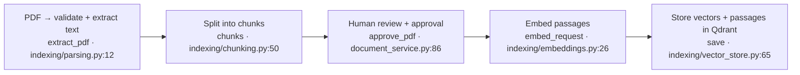
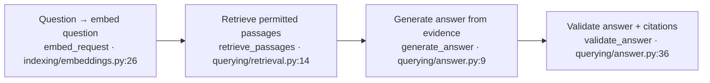

# Contact 2 rehearsal guide

**Goal:** teach learners to investigate, build, verify and review an AI application with Codex. Relay’s PDF assistant is the practical example, not the whole lesson.

**Duration:** two hours. Use the app and editor for most of the session. Open a slide only when a concept needs a short explanation: five RAG support slides and ten Codex engineering slides.

**Preparation status:** the PDF demo and page-number reference are verified. The class checkout stays in the before state; a separate completed checkout is at `~/projects/relay-contact2-reference`. You can start Section 3 in `~/projects/relay-contact2-class` on its current branch. The full timed instructor rehearsal is still yours to do. The old Markdown parser exercise is separate practice.

## Before you begin

Open `~/projects/relay-contact2-class` in the IDE. This is the isolated checkout for class edits.

Keep these two tabs open; they are pages of the same app on port **8002**:

- [PDF assistant](http://127.0.0.1:8002/teaching/contact-2)
- [Reference slides](http://127.0.0.1:8002/course/contact-2)

Use the [three-page policy PDF](http://127.0.0.1:8002/teaching/contact-2/sample-multipage.pdf) throughout this session. It is also in `workbench/teaching/contact2/pdfs/collection-policy-multipage.pdf` in the class checkout. Page 1 covers the seven-day holding period and notice date; page 2 covers collection code and identity checks; page 3 covers supervisor review before return. The rules are original synthetic teaching content, also present in the one-page sample. Remove any earlier copy from **Indexed policies** before the demonstration.

If the app is stopped, run this from the original project folder, `~/projects/history-game-codex`:

```sh
uv run --project ~/projects/relay-contact2-class/workbench \
  --locked --extra references --env-file workbench/.env \
  python ~/projects/relay-contact2-class/workbench/scripts/contact2.py \
  serve --state before --reload
```

The PDF flow works with this command. No parser-mode switching is needed. The older Markdown exercise is on `/static/contact2-markdown.html`; it is not part of this PDF page.

### Check these before starting the timer

- In the class folder, confirm `git status --short` and `git branch --show-current`. The prepared class baseline is saved as a local commit. Confirm the working tree is clean before the exercise. Keep the separate verified checkout `~/projects/relay-contact2-reference` for recovery. Do not reset or clean this checkout to hide preparation changes.
- In the original project's ignored `workbench/.env`, check locally that `RELAY_AI_PROVIDER=openrouter`, `RELAY_ALLOW_LIVE=1` and a funded `OPENROUTER_API_KEY` are configured. The prepared model IDs are `OPENROUTER_MODEL=openai/gpt-4o` and `OPENROUTER_EMBEDDING_MODEL=openai/text-embedding-3-small`. Do not display the key. Codex's login/model settings are separate from Relay's provider credentials. Local Qdrant requires no service key.
- Open the PDF assistant and confirm **Indexed policies**, below the question area, loads. Check `http://127.0.0.1:8002/api/health`; HTTP 200 establishes server health, not provider credit or answer quality. Use the launch command above only if the app is stopped. `pnpm dev` starts the baseline, not this class profile.
- Download and open both sample PDFs before class. Practise the complete three-page upload, review, index and question journey once; check the cited source ID against the uploaded document. The saved live PDF evidence currently covers the **one-page** sample, not this three-page run.
- Confirm both general skills appear in Codex, the browser tools can actually operate the local PDF UI, and the documentation MCP connection works. Terminal Playwright tests alone do not establish that the Codex UI has browser tools.
- Run the ingestion tests in block 6. The opt-in page-reference acceptance checks are intentionally red in this before state and green in the completed reference. A green existing suite does not prove the new feature works.
- Keep a terminal and the guide beside the editor. Use the same class checkout for all coding/test commands below. The server launch is the exception: it runs from the original folder to load its ignored environment file.

If dependencies are missing in the class checkout, run `uv sync --project workbench --locked --extra references`, `pnpm install --frozen-lockfile` and `pnpm exec playwright install chromium` there before rehearsal.

### Files to have ready

All paths below are relative to the class checkout unless stated otherwise. Open files directly; do not rely on remembering a previous chat.

| Item                 | Location and use                                                                                                                                                                                                                                                                                       |
| -------------------- | ------------------------------------------------------------------------------------------------------------------------------------------------------------------------------------------------------------------------------------------------------------------------------------------------------ |
| Live task            | `workbench/teaching/contact2/PAGE_REFERENCE_TASK.md` — acceptance criteria. The completed solution is in the separate reference checkout; `artifacts/PAGE_REFERENCES.patch` is a checked recovery patch.                                                                                               |
| Repository guidance  | Root `AGENTS.md`, then `workbench/teaching/contact2/AGENTS.md` — explain root and directory scope.                                                                                                                                                                                                     |
| First PDF            | `workbench/teaching/contact2/pdfs/collection-policy-multipage.pdf` — three-page walkthrough and coding task.                                                                                                                                                                                           |
| Skill reuse PDF      | `workbench/teaching/contact2/pdfs/collection-policy.pdf` — one-page version; instructions below prevent duplicate-source confusion.                                                                                                                                                                    |
| General skills       | `.agents/skills/review-change/SKILL.md` and `.agents/skills/browser-smoke-check/SKILL.md` — installed in the class checkout. Their tracked teaching copies are under `workbench/teaching/contact2/skills/`.                                                                                            |
| PDF recording        | `workbench/evidence/contact2-pdf-preparation.json` — recorded real-provider one-page result, including answer, passages and citations.                                                                                                                                                                 |
| Codex recording      | `workbench/evidence/contact2-preparation.json` — `codex.permission` for denied write, `codex.token_usage` for caching, `codex.first_attempt` / `corrective_attempt` for repair feedback, and `mcp` for the earlier remote documentation call. These are recorded results from the older Markdown task. |
| Automation artifacts | `workbench/teaching/contact2/artifacts/CODEX_REPAIR.patch` and `result-schema.json` — inspect the recorded Markdown repair and expected output shape. `codex_sdk_reference.py` is an unexecuted SDK reference.                                                                                         |
| Delivery templates   | `workbench/teaching/contact2/artifacts/HANDOVER.md` and `PR_DRAFT.md` — older-task examples; rewrite for the page-reference change rather than presenting their Markdown wording as today's result.                                                                                                    |

**Ready to rehearse the whole session means:** the before state, completed page-reference fallback, three-page answer, browser-enabled skill run and actual Codex UI controls have all been checked. The before/reference exercise pair is now prepared. Before class, still practise the Codex UI controls, browser-enabled skill and MCP connection in the client you will present.

## 1. Introduce the assignment · 0–5 minutes

**Goal:** give the class one business problem and one engineering task.

Say:

> Kora Dispatch’s policy team has sent us a PDF. Support agents need answers grounded in that policy. First, we’ll see how Relay reads it and answers questions. Then we’ll use Codex to improve the source references so an agent can find the supporting page in the original PDF.

Show the PDF assistant and the sample policy. Establish the finish line: a working answer with a source, then a reviewed code change that adds the correct page number.

The walkthrough code is grouped by job:

```text
workbench/teaching/contact2/
├── config.py
├── document_service.py  # upload/review records and removal
├── policy_store.py      # canonical sources and transactional publication
├── indexing/
│   ├── parsing.py        # PDF → exact text and pages (pypdf)
│   ├── chunking.py       # text → passages (LangChain or existing native splitter)
│   ├── embeddings.py     # passages/question → vectors (OpenAI SDK)
│   ├── vector_store.py   # vectors + passages → Qdrant
│   └── pipeline.py       # START HERE: preview_pdf() and build_index()
└── querying/
    ├── pipeline.py       # START HERE: answer_question()
    ├── retrieval.py      # question → permitted supporting passages
    └── answer.py         # evidence → grounded answer + validated citations
```

**Start at [workbench/teaching/contact2/indexing/pipeline.py:20](../../workbench/teaching/contact2/indexing/pipeline.py#L20).** It contains just two short functions:

- `preview_pdf()` calls **parse → chunk**, returning the exact text and chunks for human review. No provider request.
- `build_index()` calls **chunk → embed → store** on the reviewed source text. This is the indexing entry point. Chunking runs again against canonical text so the indexed passages match what retrieval verifies.

Follow the calls in that file from top to bottom. `parsing.py`, `chunking.py`, `embeddings.py` and `vector_store.py` implement the steps; storage no longer coordinates chunking or embedding.

The HTTP entry is `contact2_app.py`: **Upload and inspect** calls `upload_pdf()`, and **Approve and index policy** calls the review and indexing endpoints. Those endpoints use `document_service.py` for upload/review records and `policy_store.py` for transactional publication. These application checks surround the RAG pipeline; there is no SQL or upload-management code in the indexing coordinator.

`rag_reference.py` retains imports for Contact 1 callers. The duplicate root `contact2/pipeline.py` and former `pdf_pipeline.py` have been removed. The separate Markdown parser exercise uses `markdown_practice.py`; leave that practice closed during this walkthrough. Querying starts at `querying/pipeline.py` → `answer_question()`. It directly calls `retrieve_passages()`, `generate_answer()` and `validate_answer()` in that order.

Parsing uses pypdf. Chunking supports LangChain's `RecursiveCharacterTextSplitter`. Embeddings and answers use the OpenAI SDK directly, while vectors use the Qdrant client. This refactor preserves the selected splitter, model, IDs and stored index format. Do not change the splitter in an existing index without preparing a separate rebuilt index.

On the PDF page, expand **How it works · diagrams and code**, then the ingestion or retrieval diagram. The handler paths copy the FastAPI file and line. Ingestion lists upload, review and indexing handlers; retrieval also links to its policy-query operation in Swagger. Keep it collapsed during the upload/answer journey. Show these two maps before opening the code. **Ingestion prepares the policy; retrieval uses it to answer a question.** Each box names the function and its file location. The full relative paths below are the code stops to copy into your editor in the class checkout.

**Ingestion — when we upload and index a policy**



Code stops, left to right:

1. [workbench/teaching/contact2/indexing/parsing.py:12](../../workbench/teaching/contact2/indexing/parsing.py#L12) — validate the PDF and extract its text.
2. [workbench/teaching/contact2/indexing/chunking.py:50](../../workbench/teaching/contact2/indexing/chunking.py#L50) — split text into passages with exact offsets.
3. [workbench/teaching/contact2/document_service.py:86](../../workbench/teaching/contact2/document_service.py#L86) — record the supervisor's review before indexing.
4. [workbench/teaching/contact2/indexing/embeddings.py:26](../../workbench/teaching/contact2/indexing/embeddings.py#L26) — request passage embeddings.
5. [workbench/teaching/contact2/indexing/vector_store.py:65](../../workbench/teaching/contact2/indexing/vector_store.py#L65) — build the index, storing vectors and passage metadata in Qdrant. Unchanged vectors can be reused.

**Retrieval + generation — when we ask a question**



Code stops, left to right:

1. [workbench/teaching/contact2/indexing/embeddings.py:26](../../workbench/teaching/contact2/indexing/embeddings.py#L26) — embed the question using the same embedding model as the passages.
2. [workbench/teaching/contact2/querying/retrieval.py:14](../../workbench/teaching/contact2/querying/retrieval.py#L14) — apply access checks and search the index; hybrid mode also uses keyword ranking.
3. [workbench/teaching/contact2/querying/answer.py:9](../../workbench/teaching/contact2/querying/answer.py#L9) — pass retrieved evidence into the answer-generation workflow.
4. [workbench/teaching/contact2/querying/answer.py:36](../../workbench/teaching/contact2/querying/answer.py#L36) — check the result and citations before returning the final answer.

Say: “We embed the policy passages when indexing. Later, we embed the question to find relevant passages. The answer model then reads those passages; it does not search the PDF by itself.”

## 2. Demonstrate the working RAG flow · 5–30 minutes

**Goal:** learners can follow a document into the index and a question back to its evidence.

**Demo:**

1. Download the **Three-page policy PDF** from the page, select it and click **Upload and inspect**.
2. Expand **Extracted text**. Compare the PDF with what the parser actually read.
3. Expand **Text chunks**. Show the boundaries, overlap and source details.
4. Review the text, check the two confirmations and click **Approve and index policy**.
5. Expand **Embedding details** and **Qdrant record**. Show vector length, a few actual values and the stored passage.
6. Ask:

   > How long can a parcel stay at a collection point, when does that period start, and who reviews return to the sender?

7. Inspect **Retrieved passages**, the answer and its expanded source.

The question uses one normal JSON request: `POST /api/v1/policies/query`. The browser waits for the response, then shows retrieved passages, similarity scores, the answer and citations together. No streaming is used in this Contact 2 PDF flow.

For the code walkthrough: `contact2-pdf.js` → `contact2_app.py` (`query_policy`) → `querying/pipeline.py` (`answer_question`). Open that last function and follow its three calls: `retrieve_passages` → `generate_answer` → `validate_answer`. There is no case ID, investigator callback, shipment tool, conversation history or stream on this path. Retrieved passages and the final answer return in one JSON response.

The answer should explain seven calendar days from the first collection notice, with supervisor review before return. Check the supporting text rather than accepting a confident answer.

To repeat the demo, find the PDF under **Indexed policies**, click **Remove policy** and confirm. This removes that PDF from the shared teaching corpus and Qdrant, without a model call. Other policies stay in place. Upload the PDF again and repeat the steps; re-indexing can make new embedding requests.

Keep the editor beside the UI. Follow these code stops in order:

Click a code reference in the PDF page to copy its relative `file.py:line` location, then paste it into the editor’s file search. The chunking slide explains why we chunk and compares fixed-size, recursive and semantic strategies.

| What you show                                | Code under `workbench/teaching/contact2/`                       |
| -------------------------------------------- | --------------------------------------------------------------- |
| PDF extraction                               | `indexing/parsing.py` → `extract_pdf`                           |
| Chunking                                     | `indexing/chunking.py` → `chunks`                               |
| Embeddings                                   | `indexing/embeddings.py` → `EmbeddingModel.embed_request`       |
| Qdrant storage                               | `indexing/vector_store.py` → `VectorStore.save`                 |
| Indexing coordinator                         | `indexing/pipeline.py` → `preview_pdf`, `build_index`           |
| Upload and source review                     | `document_service.py` → `stage_pdf`, `approve_pdf`, `index_pdf` |
| Query embedding, retrieval and source checks | `querying/retrieval.py` → `retrieve_passages`                   |
| Grounded generation and citation checks      | `querying/answer.py` → `generate_answer`, `validate_answer`     |

Use the five RAG slides only to explain model choices, dimensions, chunking, retrieval settings and grounding. PDF extraction versus OCR and the current library choices are in the notes. Do not repeat the UI journey as a slide presentation.

**Learners should see:** extracted text → chunks → embeddings → Qdrant → retrieved passages → an answer with evidence.

## 3. Set up the Codex engineering task · 30–45 minutes

**Goal:** show how to give an agent enough context and a clear boundary before it edits code.

**Demo:**

1. Briefly confirm the class folder and branch. This is Git orientation, not a Git lesson; assume learners already know branches and worktrees.
2. Use the model/effort slide for a short explanation, then show your selected values in Codex. Do not repeat the explanation in the UI.
3. Use the repository-context slide to distinguish `AGENTS.md` from the task prompt, then open the actual instructions in the editor.
4. Use the permissions slide briefly, then point out the active sandbox/approval settings. Apply the boundary to this task.
5. Use the prompting/Plan-mode slide, then submit the task below in Plan mode. Read the proposed plan before switching to implementation.

**Teach prompting through this task:** this is a **structured zero-shot engineering prompt**. It gives no worked examples. Point out the objective, task context, constraints, acceptance criteria and expected verification. “Investigate and plan first” stages the workflow. Adding one worked input/output example makes it one-shot; several examples make it few-shot. Specifying an output format controls the result’s structure. Those are techniques to choose deliberately, not separate rituals to run for every task.

**Task prompt:**

```text
Improve Relay’s PDF assistant so retrieved passages and answer citations show
which original PDF page or pages support them.

Investigate the existing extraction-to-citation flow and propose a plan first.
Read AGENTS.md and workbench/teaching/contact2/PAGE_REFERENCE_TASK.md.
Preserve exact extracted text, access checks, review requirements and existing
citations. Derive page numbers from source metadata, not from the model.

Acceptance: a passage on page 2 shows page 2; a passage spanning pages shows
the correct range; existing PDF ingestion and permission checks still pass.
Verify the visible result and report the actual tests. No external writes
or deployment.
```

**Learners should see:** a specific objective, useful context, constraints, acceptance criteria and a plan they can inspect.

After reading the plan, check that it covers page boundaries, exact offsets, persistence, retrieval, UI rendering and regression tests. Resolve any unclear acceptance criteria now. Switch from Plan mode to implementation, then send:

```text
Implement the agreed plan in this class checkout. First add a regression test
that fails because page references are absent, then make it pass. Use disposable
test stores and fixture provider responses; no billable calls for these tests.
Preserve the task's acceptance criteria. Report changed files, actual commands,
results and any remaining gaps. Do not commit, publish or deploy.
```

## 4. Implement the improvement · 45–75 minutes

**Goal:** demonstrate the engineering loop on the PDF workflow learners just used.

**Demo:**

1. Show the current limitation: sources identify the policy and excerpt, but not the original page.
2. Use the prepared multi-page PDF to define the expected page references.
3. Run the prepared failing acceptance checks below, then ask Codex to implement the agreed change and make them pass. Add a focused regression if the implementation exposes another edge case.
4. Follow one page reference through extraction metadata, chunks, storage, retrieval and citation display.
5. Inspect failures and corrections. Explain the loop as **edit → test → inspect feedback → improve**.

Explain Goals here as continuation toward an objective, with limits and a stopping condition. Demonstrate the installed controls only after rehearsing them; Goals do not expand permissions. Keep Ralph-style outer loops to a brief optional comparison.

For a short Goal demonstration, use a separate task after saving the implementation work. Set this read-only objective: “Inspect the PDF page-reference change against PAGE_REFERENCE_TASK.md and report each criterion as met, unmet or unverified with file locations. Do not edit files, make provider calls or publish anything.” Practise starting, pausing, resuming and clearing it in your installed client before class. The documented CLI equivalents are `/goal <objective>`, `/goal pause`, `/goal resume` and `/goal clear`; UI availability must be checked locally. See [official Goals lifecycle](https://developers.openai.com/cookbook/examples/codex/using_goals_in_codex). No native Goal lifecycle recording is supplied yet. If unavailable, explain the concept and show the recorded repair loop instead.

**Learners should see:** page information derived from the document, a passing test and a visible improvement. Adding another input format is not part of this task.

## 5. Create and use a skill, then inspect MCP · 75–90 minutes

**Goal:** show how a working procedure becomes reusable instructions, and how an agent uses an external tool.

### Create the PDF skill in the Codex UI

1. Stay in the Codex project for `~/projects/relay-contact2-class`. Use implementation mode for creating the file.
2. Show the existing `.agents/skills/review-change/SKILL.md` and `.agents/skills/browser-smoke-check/SKILL.md`. Explain their `name`, `description` and instructions; invoke them in block 6.
3. In the Codex composer, select Skill Creator by typing `$skill-creator`, then paste:

```text
$skill-creator
Create an instruction-only repository skill named ingest-policy-pdf at
.agents/skills/ingest-policy-pdf/SKILL.md in this class checkout.

It should reuse Relay's existing PDF assistant at
http://127.0.0.1:8002/teaching/contact-2, not implement another pipeline.

Inputs: PDF path, policy title, test question and expected supporting facts.
Use the project's browser tools to upload and preview the PDF. Report the
extracted text and chunks, then stop for my source-review and billable-call
confirmation unless I have already explicitly provided it for this file.
Only then index it, ask the question and inspect the supporting citation.
Check page references if the page-number feature is available; otherwise
report that limitation. Report the source ID, result and actual evidence.

Use local teaching data only. Do not approve source content on my behalf,
read credentials, remove existing policies, install globally or deploy.
Do not run ingestion while authoring the skill. Create only the skill file.
```

4. Open the generated `SKILL.md`. Confirm it has YAML `name` and `description`, followed by a short procedure. It should call the existing UI/API through available browser tools, not contain a copy of the Python pipeline. If browser tools are unavailable, it should report the missing capability rather than invent an execution result.
5. Type `$ingest-policy-pdf` in a new message to select the skill. Codex detects local skill changes automatically; restart Codex if it does not appear. See [official skill authoring and discovery](https://learn.chatgpt.com/docs/build-skills).

**Invoke it with a concrete input:** the three-page PDF was the first demo; the existing one-page version is the second file for this reuse check. It contains the same rules with different pagination.

Before this reuse check, record the three-page result, then use **Remove policy** yourself to remove that earlier sample and any other rehearsal copy of the same collection policy. Do not delete unrelated policies. The one-page question must cite the newly uploaded source ID; citing an older copy would not verify this file's ingestion. The skill itself receives no removal permission.

```text
$ingest-policy-pdf
PDF: workbench/teaching/contact2/pdfs/collection-policy.pdf
Title: Parcel collection and return policy
Question: What must the recipient present when collecting a parcel?
Expected facts: the collection code and a matching identity document.

Upload and preview only. Show me the extracted text and chunks, and stop
before indexing or asking the model.
```

Read the preview, then give this follow-up if it is correct:

```text
I have reviewed this extracted policy and confirm permission for its teaching
use. Continue with indexing and one answer request using the configured
provider, then verify the source citation. Do not remove other policies.
```

Show which tool or Playwright command actually ran and what it returned. The skill itself is instructions; the browser/API tools do the work. A valid skill file is not proof that its workflow has executed.

### Connect the documentation MCP server in the Codex UI

**Do this setup before class.** During the session, show the saved connection and one tool call. The earlier `codex -C ... -c ...` command launches a separate CLI session; it does not configure an already-open Codex UI.

1. In the desktop client, open **Settings → MCP servers → Add server**. In the Codex IDE extension, use its **gear menu → MCP servers → Add server**.
2. Fill in:

   | Field          | Value                               |
   | -------------- | ----------------------------------- |
   | Name           | `openaiDeveloperDocs`               |
   | Transport/type | **Streamable HTTP**                 |
   | URL            | `https://developers.openai.com/mcp` |

3. Save and select **Restart** for the desktop connection, or **Restart extension** in the IDE. These are Codex connection controls; do not restart Relay.
4. Check the MCP server list or `/mcp` for the connection and its actual tools. This public server searches and reads documentation; it does not make OpenAI model API calls.

These steps follow [official MCP UI setup](https://learn.chatgpt.com/docs/extend/mcp) and the [OpenAI Docs MCP server](https://developers.openai.com/learn/docs-mcp). A hosted browser chat has a different plugin setup; these instructions are for the local desktop/IDE Codex client.

**Tool-call prompt:**

```text
Use the openaiDeveloperDocs MCP server to find the embeddings request's
`dimensions` parameter. Read the relevant page and explain what changes
when we choose a smaller embedding vector. Include the documentation link.
```

Expand the actual tool call and result. If the server is unavailable or Codex answered without calling it, say so; a plausible answer is not proof of MCP usage. A read-only docs server cannot demonstrate a denied write: show the prepared sandbox-denial example separately.

For that denial, open `workbench/evidence/contact2-preparation.json` at `codex.permission` and `permission_probe_exists`. Explain: a recorded read-only sandbox rejected a file write, and the probe file was not created. This is a sandbox denial, not a human approval rejection or a denied MCP operation. Do not attempt writes to real protected directories just to recreate it.

**Learners should see:** a skill file created and explicitly invoked, a source-review pause, the actual workflow result and one external MCP call. The full skill run still needs rehearsing before class.

## 6. Verify, review and prepare delivery · 90–110 minutes

**Goal:** show what makes an agent’s change ready for human review.

**Demo:**

1. Invoke `browser-smoke-check` on the PDF journey. Check a page-2 passage, a passage spanning pages and the expanded answer source.
2. Confirm access restrictions and existing ingestion behavior still work.
3. Invoke `review-change` on the actual diff. Inspect its findings against code and test results.
4. Prepare a local PR draft describing the problem, resulting behavior, tests and remaining limits.

Existing ingestion checks can be run from the class checkout with:

```sh
workbench/.venv/bin/python -m pytest workbench/tests/test_contact2_ingestion.py -q
```

Run the page-reference acceptance from the class checkout:

```sh
workbench/.venv/bin/python -m pytest -c workbench/pyproject.toml \
  workbench/teaching/contact2/reference_tests/page_reference_acceptance.py -q
```

Expected before implementation: **five failures**, with zero provider calls. Expected after: **five passes**. These opt-in checks are outside the normal green starter suite. They cover exact page boundaries, page 2, cross-page passages, metadata freshness, Qdrant persistence and API citations. Keep their acceptance criteria unchanged while implementing the fix.

After adding the feature, regenerate the copyable locations with `workbench/.venv/bin/python workbench/scripts/contact1_references.py --write`; format the affected HTML with Prettier. Remove the old sample through **Indexed policies**, then upload and review it again: previously saved policies do not contain page metadata. This is a deliberate source update, not a database reset.

Use these prompts for the two installed skills:

```text
$browser-smoke-check
Verify the PDF page-reference task at http://127.0.0.1:8002/teaching/contact-2
against workbench/teaching/contact2/PAGE_REFERENCE_TASK.md. Use a disposable
browser context and fixture-backed checks where possible. Report a passage
within page 2, a passage spanning pages and the expanded answer citation.
Do not index, remove policies or make billable calls without my confirmation.
Report what could not be checked and label fixture versus live evidence.
```

```text
$review-change
Review the current exercise diff against
workbench/teaching/contact2/PAGE_REFERENCE_TASK.md. Inspect relevant callers
and tests. Report concrete findings with file locations and unverified criteria.
Do not patch, commit or publish anything.
```

The existing fixture PDF browser check is `pnpm exec playwright test --config workbench/playwright.config.ts --grep 'PDF RAG'`. It manages its own test server; it is not a live provider check and currently does not assert the proposed page-number feature. Do not use `pnpm contact2:browser` or `contact2:check` as page-reference acceptance: those commands still target the older Markdown exercise.

Before reviewing, run `git diff --stat`, `git diff --check` and `git status --short`; inspect newly created files too, since ordinary `git diff` omits untracked content. Rewrite the local PR draft around the page-reference problem, resulting behavior, actual checks and limits. Keep that draft outside the code diff if convenient.

**Learners should see:** tests, browser evidence and a scoped diff supporting the PR—not just an agent completion message. Publishing a remote PR or deploying is outside this demonstration.

## 7. Explain reuse and hand over · 110–120 minutes

**Goal:** connect the engineering task to context, caching and repeatable automation.

**Demo:**

1. Write a short handover: objective, changed files, checks run, results and next step. Explain what a fresh task needs to receive.
2. Compare **prompt caching** (eligible repeated model input), **embedding reuse** (unchanged stored vectors) and **conversation history** (earlier exchanges supplied or continued). Use recorded cached-token usage if the live route does not report it.
3. Inspect the prepared non-interactive Codex CLI run and its result. It demonstrates automation mechanics; its recorded Markdown task is not evidence for the new page-reference feature.
4. Take questions. Keep SDK/cloud/Windsurf comparisons optional. Temporal, scheduling and the full publication workflow remain Contact 3.

**Learners should leave able to explain:** what entered the model, what the agent could do, how its change was verified and how another engineer could continue the work.

For the handover, ask: “Summarize this task for a fresh Codex conversation: objective, class folder and branch, changed files, actual verification results, evidence paths, unfinished work and permission boundaries.” Paste it into a fresh task with the relevant files; saving it alone does not supply context automatically.

In the recorded Codex evidence, the first repair run reports 207,728 input tokens, including 183,808 cached input tokens. These are aggregate usage for that recorded run, not a guaranteed saving for the next prompt. Contrast that with the PDF recording's `repeat_embedding_calls: 0`: unchanged vectors were reused. Relay has no answer cache here. Inspect `CODEX_REPAIR.patch` beside the recorded first/corrective results to explain non-interactive automation; the SDK example has not been executed.

### Recovery and timing

- **Extraction fails:** confirm the supplied text PDF opens locally. Scanned/image-only PDFs need OCR, which this demo does not implement. Use the prepared sample rather than adding another parser live.
- **Provider/auth/rate-limit failure:** keep extraction/chunk inspection offline, show the recorded one-page answer and its citations, and label it recorded. Check the local environment/account after the demonstration; do not expose credentials or substitute a fabricated answer.
- **Edit outside the reload watcher:** `--reload` watches Python under `workbench/teaching/contact2/`. Changes elsewhere may require restarting the same class server; browser reload picks up static assets. Stop only that server with Ctrl-C, then use the launch command above. Do not start a second index process against its open Qdrant store.
- **Repeated upload problem:** remove the intended indexed PDF through the UI and upload again. Preview limits are ten per workspace per day; removing an indexed PDF clears its matching staged previews. If unindexed previews exhaust the quota, stop and investigate instead of deleting the database.
- **Coding runs past minute 75:** open the completed `~/projects/relay-contact2-reference` checkout to inspect the solution and its passing checks. To show its UI, stop the class server with Ctrl-C and launch the reference with the same command from “Before you begin”, replacing both occurrences of `relay-contact2-class` with `relay-contact2-reference`. Keep port 8002 as the only app server. The reference has its own runtime data; upload, review and index the sample there explicitly. A new corpus may require embedding calls. If the provider is unavailable, use `workbench/evidence/desktop-contact2-page-reference.png` and label it a recorded browser fixture.
- **Patch recovery:** `artifacts/PAGE_REFERENCES.patch` applies to the unchanged before state. Run `git apply --check workbench/teaching/contact2/artifacts/PAGE_REFERENCES.patch` before applying. If your live edits conflict, inspect the separate reference instead; do not reset or overwrite your work to force the patch.
- **Protect the rest of the lesson:** preconfigure MCP before class. If time slips, use a rehearsed generated skill rather than authoring it from scratch; still show its instructions, explicit invocation and review pause. Cut optional Ralph, SDK and alternative-editor discussion first. Keep verification, diff review and handover.

## Before you teach

Section 3 is ready to rehearse. Stay in `~/projects/relay-contact2-class` on `relay/contact2-rehearsal`; no branch change is needed. The completed solution is saved separately on `relay/contact2-pages-reference` in `~/projects/relay-contact2-reference`.

Preparation evidence is `workbench/evidence/contact2-page-reference-preparation.json`: five expected before failures, five reference passes, 197 passing regression checks with two optional skips, and two passing desktop/mobile browser fixture checks. The reference has not been live-provider verified or timed by the instructor.

Still rehearse the PDF skill's second-file run and configure/check MCP in your actual Codex UI before teaching block 5. A terminal MCP test does not establish the connection in your UI. Rehearse the full two-hour timing after those checks.

The saved PDF run predates the direct policy-query route; it is not live verification of that new route. If the provider fails during class, show the saved PDF run at `workbench/evidence/contact2-pdf-preparation.json` and label it as recorded evidence. Use **Remove policy** for a repeat demonstration rather than resetting the database. Rehearse the full two hours after the replacement exercise is prepared.
